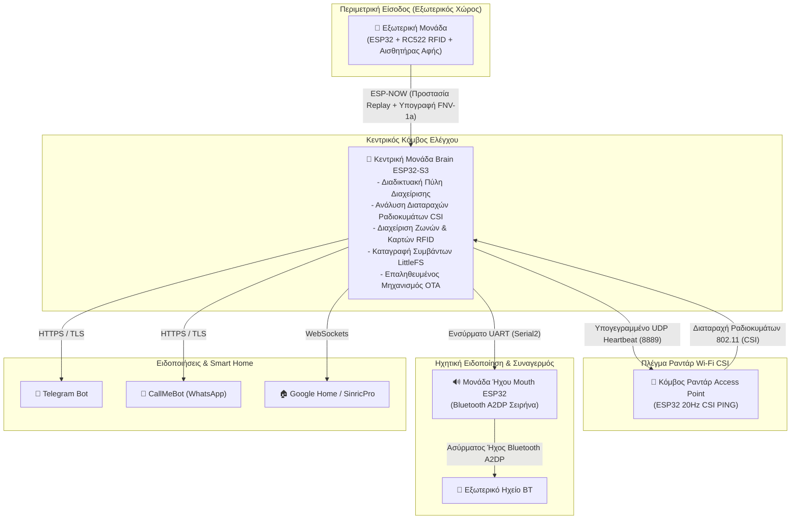

# 🛡️ Ολοκληρωμένο Έξυπνο Σύστημα Ασφαλείας & Ραντάρ Wi-Fi CSI

<div align="center">

**Languages / Γλώσσες:**  
[🇬🇧 English](README.md) &nbsp;•&nbsp; [🇬🇷 Ελληνικά](README.el.md)

</div>

[](https://platformio.org/)
[](https://www.arduino.cc/)
[](https://www.espressif.com/en/products/socs/esp32-s3)
[](LICENSE)

Ένα προηγμένο, αποκεντρωμένο σύστημα οικιακής ασφάλειας IoT βασισμένο σε μικροελεγκτές **ESP32**. Διαθέτει ανίχνευση κίνησης μέσω **Wi-Fi Channel State Information (CSI) Radar** (χωρίς κάμερες), εξωτερική μονάδα RFID εξαιρετικά χαμηλής κατανάλωσης μπαταρίας, κεντρική μονάδα ελέγχου (Brain) με web περιβάλλον διαχείρισης και ειδικό κόμβο σειρήνας ήχου μέσω Bluetooth A2DP.

---

## 🏛️ Αρχιτεκτονική Συστήματος



---

## ✨ Κύρια Χαρακτηριστικά

### 1. 🧠 Κεντρική Μονάδα (`firmware/brain-esp32-s3`)
* **Διαδικτυακή Πύλη Διαχείρισης:** Πλήρως responsive web interface προστατευμένο με **HTTP Basic Authentication** και κωδικούς οριζόμενους από τον χρήστη.
* **Ραντάρ Wi-Fi CSI:** Αναλύει τις μικροδιακυμάνσεις του πλάτους των υποφορέων Wi-Fi (CSI) για τον εντοπισμό ανθρώπινης κίνησης στον χώρο χωρίς χρήση καμερών.
* **Διαχείριση Ζωνών Πρόσβασης:** Υποστήριξη πολλαπλών ανεξάρτητων ζωνών ρελέ, εγγραφή καρτών διαχειριστή και εξουσιοδοτημένων χρηστών RFID.
* **Χρονοπρογραμματισμός Όπλισης:** Ρύθμιση αυτόματης όπλισης/αφόπλισης ανά ημέρα, συγκεκριμένες ημερομηνίες ή 24ωρη λειτουργία.
* **Μη Πτητικά Αρχεία Καταγραφής (LittleFS):** Αυτόματη κυκλική καταγραφή ιστορικού (έως 1MB) στην εσωτερική μνήμη flash, με δυνατότητα λήψης αρχείου από το web interface.
* **Επαληθευμένη Αναβάθμιση OTA:** Ασφαλής ασύρματη ενημέρωση firmware με επαλήθευση του αναγνωριστικού byte της εικόνας ESP32 (`0xE9`), αποτρέποντας την καταστροφή της μνήμης από εσφαλμένα αρχεία.
* **Πολλαπλά Κανάλια Ειδοποίησης:** Άμεση αποστολή μηνυμάτων σε Telegram, WhatsApp (CallMeBot) και τοπικές ενδείξεις RGB LED.

### 2. 🚪 Εξωτερική Μονάδα (`firmware/outside-module`)
* **Εξαιρετικά Χαμηλή Κατανάλωση:** Παραμένει σε κατάσταση deep sleep και ενεργοποιείται άμεσα μόλις ο χρήστης αγγίξει το χωρητικό πλήκτρο (`TTP223B`).
* **Προστασία Replay Attack:** Αυστηρά μονότονος μετρητής καταχωρημένος στη **μη πτητική μνήμη flash (NVS/Preferences)** που αποτρέπει την επανάληψη υποκλαπέντων πακέτων, ακόμα και μετά από αλλαγή μπαταρίας.
* **Κρυπτογραφική Υπογραφή FNV-1a:** Κάθε μετάδοση περιλαμβάνει κρυπτογραφικό κατακερματισμό υπολογισμένο επί του UID της κάρτας, του μετρητή και κοινού μυστικού κλειδιού.
* **Αυτόματη Σύζευξη:** Συνδέεται αυτόματα με την κεντρική μονάδα κατά την πρώτη έγκυρη σάρωση και κλειδώνει τη διεύθυνση MAC.

### 3. 📡 Κόμβος Ραντάρ (`firmware/access-point-radar`)
* Εκπέμπει συγχρονισμένα πακέτα Wi-Fi υψηλής συχνότητας (20Hz) αποκλειστικά όταν το σύστημα είναι οπλισμένο.
* Επαληθεύει την κατάσταση όπλισης μέσω ψηφιακά υπογεγραμμένων πακέτων UDP broadcast (`RADAR_UDP_TOKEN`).
* Το Wi-Fi modem απενεργοποιείται αυτόματα σε κατάσταση αναμονής (standby) όταν το σύστημα αφοπλίζεται.

### 4. 🔊 Κόμβος Ήχου / Σειρήνας (`firmware/mouth-esp32`)
* Συνδέεται ενσύρματα μέσω UART (`Serial2`) με την κεντρική μονάδα.
* Μεταδίδει ήχο σειρήνας υψηλής πιστότητας PCM μέσω **Bluetooth A2DP** σε οποιοδήποτε ασύρματο ηχείο ή soundbar.
* Αποθηκεύει το όνομα του επιθυμητού ηχείου απευθείας στη μνήμη flash.

---

## 📁 Δομή Αποθετηρίου (Repository)

```text
Security-System/
├── firmware/
│   ├── brain-esp32-s3/            # Κεντρικός ελεγκτής & Web Server (ESP32-S3)
│   ├── outside-module/            # Εξωτερική μονάδα RFID με μπαταρία (ESP32 DevKit)
│   ├── access-point-radar/        # Κόμβος ραντάρ Wi-Fi CSI (ESP32 Dev Module)
│   └── mouth-esp32/               # Σειρήνα ήχου Bluetooth A2DP (ESP32 DevKit)
├── hardware/
│   ├── 3d-models/                 # 3D εκτυπώσιμα κουτιά (STL, 3MF, FreeCAD)
│   ├── pcb/                       # Σχεδιαγράμματα PCB και αρχεία KiCad
│   └── pinouts/                   # Διαγράμματα συνδεσμολογίας και ακροδεκτών
├── docs/                          # Τεκμηρίωση, παρουσιάσεις και εικόνες
├── security-system.code-workspace # Αρχείο χώρου εργασίας VS Code Multi-Root
├── .gitignore                     # Κανόνες αποκλεισμού αρχείων κατασκευής & κλειδιών
└── README.md                      # Τεκμηρίωση έργου
```

---

## 🚀 Οδηγός Εγκατάστασης & Εκκίνησης

### Προαπαιτούμενα
* [PlatformIO IDE](https://platformio.org/) (επέκταση για το VS Code) ή το PlatformIO CLI.
* Git.

### 1. Κλωνοποίηση του Αποθετηρίου
```bash
git clone https://github.com/Apras4356/Security-System.git
cd Security-System
```

### 2. Άνοιγμα στο VS Code
Ανοίξτε το αρχείο `security-system.code-workspace` στο VS Code. Το PlatformIO θα ρυθμίσει και θα αναγνωρίσει αυτόματα και τα 4 firmware projects.

### 3. Ρύθμιση Μυστικών Κλειδιών
Πριν τον προγραμματισμό των πλακετών, ορίστε τα δικά σας μοναδικά κρυπτογραφικά κλειδιά στα αρχεία `firmware/brain-esp32-s3/include/Config.h`, `firmware/outside-module/src/main.cpp`, και `firmware/access-point-radar/src/main.cpp`:

```cpp
#define RADAR_UDP_TOKEN "Το_Δικό_Σας_Μυστικό_Κλειδί_Ραντάρ"
#define ESPNOW_SECRET_KEY "Το_Δικό_Σας_Μυστικό_Κλειδί_ESPNow"
```

### 4. Μεταγλώττιση και Προγραμματισμός (Flashing)
Χρησιμοποιήστε το PlatformIO Project Switcher (ή το CLI) για μεταγλώττιση και φόρτωση σε κάθε πλακέτα:

```bash
# Προγραμματισμός Κεντρικής Μονάδας (Brain)
pio run -d firmware/brain-esp32-s3 -t upload

# Προγραμματισμός Εξωτερικής Μονάδας (Outside Module)
pio run -d firmware/outside-module -t upload

# Προγραμματισμός Κόμβου Ραντάρ (Radar Node)
pio run -d firmware/access-point-radar -t upload

# Προγραμματισμός Μονάδας Ήχου (Mouth Siren)
pio run -d firmware/mouth-esp32 -t upload
```

---

## 🔒 Βέλτιστες Πρακτικές Ασφαλείας

1. **Αρχική Σύνδεση Wi-Fi:** Κατά την πρώτη εκκίνηση, το Brain δημιουργεί το δίκτυο `SecuritySystem-Setup` (κωδικός: `SecuredESP32Setup!`). Συνδεθείτε σε αυτό για να καταχωρίσετε το οικιακό σας Wi-Fi.
2. **Κωδικοί Διαχειριστή Web:** Οι προεπιλεγμένοι κωδικοί είναι `admin` / `admin`. Μετά την πρώτη είσοδο στη διεύθυνση `http://<brain-ip>/settings`, ορίστε άμεσα νέο όνομα χρήστη και ισχυρό κωδικό.
3. **Απόκρυψη Κλειδιών API:** Τα αποθηκευμένα tokens (Telegram, Sinric) εμφανίζονται με τελείες (`••••••••••••`) στη σελίδα ρυθμίσεων για αποφυγή υποκλοπής.
4. **Επαλήθευση Firmware:** Ο μηχανισμός OTA επαληθεύει τη μορφή του δυαδικού αρχείου πριν την εγγραφή στην flash μνήμη για προστασία από αλλοιωμένα αρχεία.

---

## 📄 Άδεια Χρήσης
Το έργο διατίθεται ως λογισμικό ανοιχτού κώδικα υπό την άδεια [MIT License](LICENSE).
