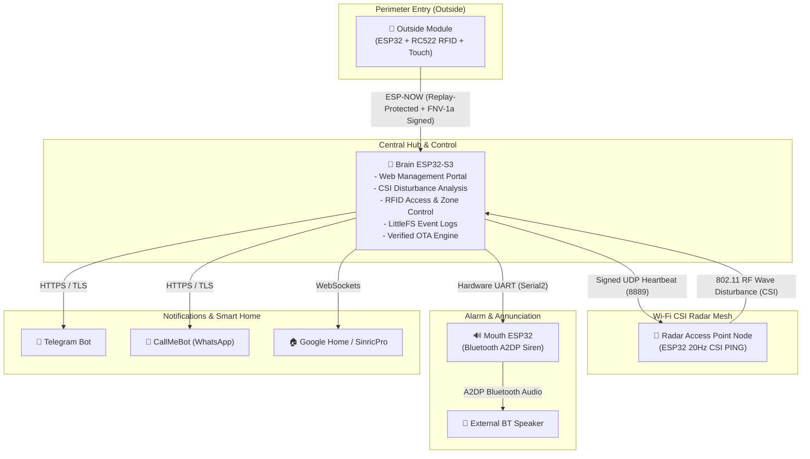

# 🛡️ Integrated Smart Security & Wi-Fi CSI Radar System

[](https://platformio.org/)
[](https://www.arduino.cc/)
[](https://www.espressif.com/en/products/socs/esp32-s3)
[](LICENSE)

An advanced, decentralized IoT home security system powered by **ESP32** microcontrollers. Features physical **Wi-Fi Channel State Information (CSI) radar detection**, an ultra-low-power battery-operated outside RFID keypad, a central web-enabled Brain controller, and a dedicated Bluetooth audio siren node.

---

## 🏛️ System Architecture



---

## ✨ Key Features

### 1. 🧠 Central Hub (`firmware/brain-esp32-s3`)
* **Interactive Web Portal:** Responsive administrative interface protected by **HTTP Basic Authentication** with user-defined credentials.
* **Wi-Fi CSI Radar:** Analyzes RF wave variances (subcarrier amplitude fluctuations) from radar nodes to detect moving intruders without cameras.
* **Access Zone Management:** Supports multiple relay zones, master RFID enrollment, and access cards.
* **Automated Arming Scheduler:** Configure specific arm/disarm times, weekday schedules, or full-day armed periods.
* **Persistent LittleFS Logs:** Rotating 1MB event log stored on internal flash, downloadable directly from the web interface.
* **Verified OTA Updates:** Password-protected over-the-air firmware updates enforcing ESP32 binary image magic-byte verification (`0xE9`).
* **Multi-Channel Alerts:** Instant dispatch to Telegram, WhatsApp (CallMeBot), and local RGB status indicators.

### 2. 🚪 Outside Module (`firmware/outside-module`)
* **Ultra-Low Power:** Wakes from deep sleep instantly when touching the capacitive pad (`TTP223B`).
* **Replay Protection:** Monotonic transaction counter persisted in **Non-Volatile Storage (NVS)** ensures every scan has a unique sequence number.
* **Cryptographic Signing:** Each RFID transmission is signed with an FNV-1a hash over the card UID, counter, and pre-shared key.
* **Auto-Pairing:** Pairs with the Brain on first authorized scan, locking the Brain to its MAC address.

### 3. 📡 Radar Node (`firmware/access-point-radar`)
* Emits high-frequency (20Hz) synchronized Wi-Fi packets when the system is armed.
* Communicates arm/disarm states via cryptographic token-signed UDP broadcasts (`RADAR_UDP_TOKEN`).
* Wi-Fi modem automatically cools down and enters low-power standby when disarmed.

### 4. 🔊 Mouth ESP32 (`firmware/mouth-esp32`)
* Connects via hardware UART (`Serial2`) to the Brain.
* Streams high-bitrate PCM siren audio over **Bluetooth A2DP** to any wireless speaker or soundbar.
* Dynamically stores target speaker pairing names in flash memory.

---

## 📁 Repository Structure

```text
Security-System/
├── firmware/
│   ├── brain-esp32-s3/            # Central controller & Web Server (ESP32-S3)
│   ├── outside-module/            # RFID battery node (ESP32 DevKit)
│   ├── access-point-radar/        # Wi-Fi CSI sensing node (ESP32 Dev Module)
│   └── mouth-esp32/               # Bluetooth A2DP audio siren (ESP32 DevKit)
├── hardware/
│   ├── 3d-models/                 # 3D printable enclosures (STL, 3MF, FreeCAD)
│   ├── pcb/                       # Custom PCB schematics and Gerber files
│   └── pinouts/                   # Hardware wiring and pinout diagrams
├── docs/                          # Presentation decks, documentation, and assets
├── security-system.code-workspace # VS Code multi-root workspace file
├── .gitignore                     # Git ignore rules for build artifacts & tokens
└── README.md                      # Project documentation
```

---

## 🚀 Getting Started

### Prerequisites
* [PlatformIO IDE](https://platformio.org/) (for VS Code) or the PlatformIO CLI.
* Git.

### 1. Clone the Repository
```bash
git clone https://github.com/Apras4356/Security-System.git
cd Security-System
```

### 2. Open in VS Code
Open the file `security-system.code-workspace` in VS Code. PlatformIO will automatically register and configure all 4 firmware projects.

### 3. Configure Pre-Shared Keys
Before flashing to hardware, customize your secret keys in `firmware/brain-esp32-s3/include/Config.h`, `firmware/outside-module/src/main.cpp`, and `firmware/access-point-radar/src/main.cpp`:

```cpp
#define RADAR_UDP_TOKEN "Your_Custom_Radar_Secret_Token"
#define ESPNOW_SECRET_KEY "Your_Custom_ESPNow_Secret_Key"
```

### 4. Build and Flash
Use the PlatformIO Project Switcher (or CLI) to compile and flash each node:

```bash
# Build Brain
pio run -d firmware/brain-esp32-s3 -t upload

# Build Outside Module
pio run -d firmware/outside-module -t upload

# Build Radar Node
pio run -d firmware/access-point-radar -t upload

# Build Mouth Siren
pio run -d firmware/mouth-esp32 -t upload
```

---

## 🔒 Security Best Practices

1. **Initial Setup:** On initial boot, the Brain creates a setup access point `SecuritySystem-Setup` (password: `SecuredESP32Setup!`). Connect to it to enter your home Wi-Fi credentials.
2. **Web Admin Credentials:** Default web credentials are `admin` / `admin`. Upon first login at `http://<brain-ip>/settings`, define a secure administrator username and password.
3. **Secret Masking:** Stored API tokens (Telegram, Sinric) are masked with `••••••••••••` in the UI to prevent shoulder-surfing.
4. **Firmware Verification:** The OTA update handler verifies the binary format before writing to flash to safeguard against malformed firmware.

---

## 📄 License
This project is open-source and released under the [MIT License](LICENSE).

